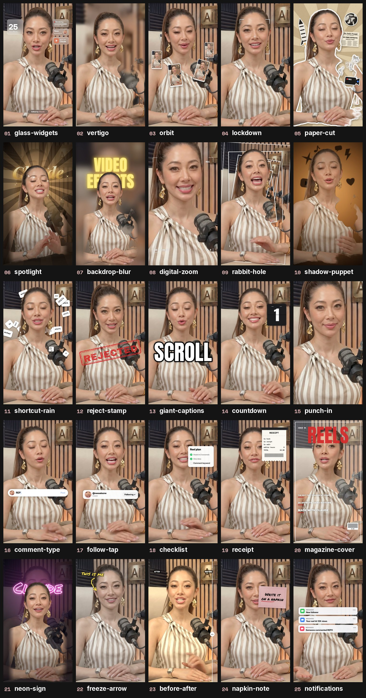

# 25 Free Reel Effects for Claude Code

Add reel effects to your talking-head videos from inside Claude Code. Drop your video into the chat, type `/reel-fx` and the name of an effect, and Claude does the edit.

Made by Ness ([@nessalazne](https://instagram.com/nessalazne)).

> **Want the full studio?** These 25 effects are free. **[FX Studio](https://builds.digicuratoragency.com/fx-studio/)** has 160+ effects plus the Style Builder, for editing your videos with Claude.



## Install (one line)

Open the Terminal app (or the terminal inside Claude Code) and paste:

```bash
git clone https://github.com/nessalazne/claude-reel-effects ~/.claude/skills/reel-fx
```

On Windows (PowerShell), use `$HOME\.claude\skills\reel-fx` in place of `~/.claude/skills/reel-fx`.

Then restart Claude Code.

> Not sure how? Open Claude Code and paste: **"Install the skill from github.com/nessalazne/claude-reel-effects into ~/.claude/skills/reel-fx"**. Claude will do it for you.

## Use it

1. Open Claude Code (the app or the terminal).
2. Drag your video into the chat.
3. Type the effect you want:

```
/reel-fx orbit from 3 to 6 seconds
/reel-fx spotlight when I say "watch this", with the word Claude behind me
/reel-fx comment-type at the end, typing REPO
/reel-fx glass-widgets for the first 2 seconds, with the number 25
```

The first time, Claude sets itself up (2 to 3 minutes). It needs `ffmpeg` and Python, and it installs them for you if they're missing.

Claude checks a few still frames first, fixes anything that covers your face, then renders `yourvideo_reelfx.mp4` next to your original. Your sound stays exactly as it was.

You can stack effects in one go: *"Orbit from 2 to 4 seconds, then a reject stamp when I say 'no', then comment-type with REPO at the end."*

## The 25 effects

| # | Type this | What happens |
|---|---|---|
| 1 | `glass-widgets` | Frosted glass cards float around your head |
| 2 | `vertigo` | Dolly zoom: the room rushes in while you stay the same size |
| 3 | `orbit` | Your reels circle you, passing behind and in front |
| 4 | `lockdown` | Camera brackets lock onto your face |
| 5 | `paper-cut` | You become a paper sticker on a newspaper collage |
| 6 | `spotlight` | The lights go down, gold rays and a glowing word appear behind you |
| 7 | `backdrop-blur` | The room blurs and a giant glowing word rises behind you |
| 8 | `digital-zoom` | Camcorder screen with REC, timecode and a 2x then 4x zoom |
| 9 | `rabbit-hole` | The room tunnels away behind you |
| 10 | `shadow-puppet` | Shadow icons drift across a warm, dark wall behind you |
| 11 | `shortcut-rain` | Keyboard keys rain down behind you |
| 12 | `reject-stamp` | A big red stamp slams down |
| 13 | `giant-captions` | Huge captions, one spoken word at a time |
| 14 | `countdown` | A 3, 2, 1 flip clock next to your head |
| 15 | `punch-in` | A fast zoom on one line |
| 16 | `comment-type` | A comment bar types your keyword and posts it |
| 17 | `follow-tap` | A Follow button flips to Following |
| 18 | `checklist` | A to-do card ticks itself off as you talk |
| 19 | `receipt` | Your lines print out like a receipt |
| 20 | `magazine-cover` | You become a magazine cover |
| 21 | `neon-sign` | The lights drop and a neon word buzzes on behind you |
| 22 | `freeze-arrow` | Freeze frame with a hand-drawn arrow pointing at you |
| 23 | `before-after` | A slider wipes from plain to graded |
| 24 | `napkin-note` | A blush napkin with your line in marker pops in |
| 25 | `notifications` | Message alerts pop in one after another |

Every effect follows your face and is placed so it doesn't cover it: words and shapes go behind your head, cards go beside it or on your chest.

**Tips**
- Vertical phone videos with you in frame work best. Wide videos are cropped to vertical around your face.
- Say the timing in plain words ("when I say 'watch'"). Claude finds the exact second.
- Want your own reel covers in `orbit`? Give Claude a folder of screenshots.
- Numbers and headlines should be your real ones. Tell Claude what they are.
- Keep each effect short: 1 to 4 seconds looks best.

## Honest notes
- These are **starter versions** of each look, with no sound design.
- Claude drafts, you approve. Watch the result before you post.
- No music or sound effects are added. `giant-captions` is the only effect that adds captions.
- It renders 1080x1920 at 30 fps. Expect roughly 10 to 15 seconds of rendering for each second of effect.
- Built and tested on a Mac. Windows works through `scripts/setup.ps1`, but it has had less testing.

## If something goes wrong
Tell Claude what you see ("the word covers my face", "it's too fast"). It changes the plan, checks the frames and renders again.

## Go further

Want more than 25? **[FX Studio](https://builds.digicuratoragency.com/fx-studio/)** has 160+ effects plus the Style Builder, for editing your videos with Claude.

New effects and tutorials on Instagram: [@nessalazne](https://instagram.com/nessalazne)

## Credits
Person cut-out and face tracking: [MediaPipe](https://ai.google.dev/edge/mediapipe/solutions/guide) models (Apache 2.0, downloaded during setup, see `models/NOTICE.md`). Word timings: [faster-whisper](https://github.com/SYSTRAN/faster-whisper) (MIT). Rendering: [Playwright](https://playwright.dev) (Apache 2.0) and ffmpeg. Fonts: Inter, Anton, Playfair Display, Space Mono and Archivo Black (SIL OFL) and Permanent Marker (Apache 2.0); licences are in `fonts/`. Everything else: MIT, see `LICENSE`.
